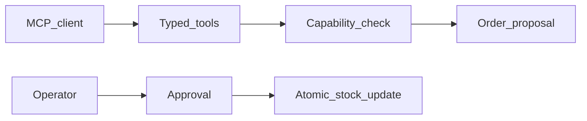

# MCP Business Tools

Typed inventory tools with capability checks and order approval.

[](https://github.com/danielpdev/mcp-business-tools/actions/workflows/ci.yml)

**Role focus:** MCP / Agent Integration / Python. **Status:** working local portfolio implementation, with synthetic data.

## The engineering decision

The MCP server exposes inventory reads and order preparation. Capability scopes come from the server process, never from tool arguments. Stock is committed only through a separate operator approval surface.



## Run locally

Requirements: Python 3.12, [uv](https://docs.astral.sh/uv/getting-started/installation/) and Make.

```bash
git clone https://github.com/danielpdev/mcp-business-tools.git
cd mcp-business-tools
make setup
make demo
make test
make eval
```

`make demo` uses an isolated temporary database where relevant, so it is safe to repeat. `make eval` writes a timestamped report to `reports/evaluation-fixture.json`. Fixture mode is deterministic and does not represent model inference. There is no recurring hosting or API subscription cost.

`make serve` opens the local API on `http://127.0.0.1:8105/docs`.

### MCP transport

```bash
uv run --frozen python -m app.server
```

This starts the official Python SDK 2.3.0 stdio server. Configure your MCP client to launch that command from this repository directory. The default capability is inventory read. Set `MCP_SCOPES=inventory:read,orders:prepare` in the **server operator environment** to permit proposals. Approval is deliberately absent from MCP tools.

[Watch the recorded demo](docs/demo.mp4) · [Reproduce the walkthrough](docs/DEMO.md)

## Verification and evidence

Real stdio client/server initialization, tool discovery, forbidden capabilities, invalid quantities, expiry, action fingerprints and approval replay.

- [Evaluation report](reports/evaluation-fixture.json) — measured during an actual run; inspect the mode and dataset size.
- [Development and authorship](docs/DEVELOPMENT.md).
- [Romanian interview preparation](docs/INTERVIEW_RO.md).
- [Design notes](docs/DESIGN.md).
- [Demo walkthrough](docs/DEMO.md).

CI uses standard GitHub-hosted runners and deterministic tests without downloading LLM weights. The lockfiles record exact package versions. Local-model results, when present, live in `reports/evaluation-local.json`; hardware/model identities are in `reports/environment.json`.

## Limits and next iteration

Stdio deployment trusts the machine operator. The separate local approval API is not a production authenticated operator console. Preparing an order does not reserve stock.

Next: Add per-user authentication and reservation expiry without letting the model grant itself scopes.

The local demonstration does not include production authentication, secret management or operational service guarantees. Bind it to localhost and use synthetic data. These projects demonstrate engineering decisions; they do not claim real customers, paid production deployments or guaranteed interviews.

## Project ownership

Implemented with Codex assistance for Daniel Popa. The owner should review the code, run it, make an independent change and rehearse the tradeoffs before presenting it at interview. That human understanding check is pending and cannot be verified automatically. See [development notes](docs/DEVELOPMENT.md).

MIT for original source; dependencies/models retain their own licenses. See [third-party notices](THIRD_PARTY.md).
